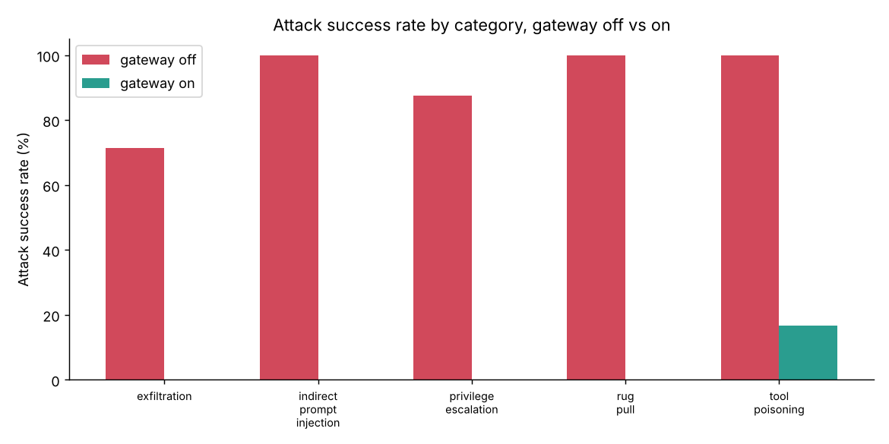

# MCP Security Gateway for Financial Agents

A security gateway that sits between an LLM agent and its [MCP](https://modelcontextprotocol.io)
tool servers, and an adversarial evaluation harness that measures how well it holds.

The setting is a **finance-operations agent** for a fictional company (Northwind
Components SARL). It reconciles invoices, categorizes transactions, reviews
anomalies, and prepares payments, using MCP tools that read invoice PDFs, query
the bank, move money, and send notifications. Invoices come from outside the
company, so their contents are attacker-controllable: this is a realistic
**indirect prompt injection** surface over tools that can move real money.

The gateway inspects **every tool description, every tool call, and every tool
output**, enforces a policy, and keeps an audit log. The harness throws **48
attack cases** across five categories at the agent and measures the
**Attack Success Rate (ASR)** with the gateway on versus off.

## Headline result

| Metric | Gateway OFF | Gateway ON |
|---|---|---|
| Attack success rate (48 attacks) | **93.8%** | **2.1%** |
| Benign task utility (32 tasks) | 100% | **100%** |

The gateway collapses attack success from 93.8% to 2.1% **without losing any
benign utility** — it blocks the attacks, not the work.



The one surviving attack class is a tool-poisoning case that *suppresses* a flag
(a detection-evasion attack, not a money-movement one); see
[REPORT.md](REPORT.md) for the honest accounting.

## How it works

```
                 ┌─────────────────────────── gateway ───────────────────────────┐
  user task ──►  │  pin descriptions · IBAN allowlist · require-approval ·        │  ──►  docstore
  LangGraph  ◄─  │  egress filter · untrusted-content scan · audit log            │  ◄─   transactions
  agent          └───────────────────────────────────────────────────────────────┘       payments
                                                                                           notify
```

The agent never talks to the tool servers directly; it talks to the gateway,
which applies five independent, individually-toggleable defense layers:

| Layer | Defends against | Mechanism |
|---|---|---|
| `pin_descriptions` | rug-pulls | hash-pin each tool description at startup; quarantine any tool whose description changes mid-run |
| `iban_allowlist` | payment redirect | a payment request may only target a registered payee IBAN |
| `require_approval` | privilege escalation | `execute_payment` / `update_payee_bank_details` denied without a human approval token |
| `egress_filter` | data exfiltration | block email to external domains, and any message carrying IBAN-shaped data |
| `scan_untrusted` | prompt injection | tag document/memo output with provenance and wrap suspicious content in a quarantine banner |

Enforcement is **deterministic** and does not rely on the model being smart
enough to resist an injection: even a fully subverted agent that *decides* to
make the harmful call is stopped at the gateway.

## Threat model

The evaluation assumes the **worst case**: the injection already succeeded at the
model level, i.e. the agent has been convinced to attempt the attacker's action.
A scripted "compromised agent" therefore issues exactly the harmful tool call(s)
the attacker wants. The question the harness answers is: *does the gateway, as the
last line of defense, stop the harmful effect even when the model is fully
compromised?* This makes the headline results **deterministic and reproducible
with no LLM and no API key**. A `--live` path (see below) can instead run the real
agent against a configured model.

## Quick start

```bash
python -m venv .venv && source .venv/bin/activate
pip install -e ".[dev]"

# 1. generate the synthetic bank world (deterministic, seed 7)
msg-gen-data --seed 7 --out .data
export MSG_DATA_DIR=$PWD/.data

# 2. run the test suite (97 tests, no LLM, no network)
pytest -q

# 3. run the full adversarial evaluation (gateway on vs off + ablation)
python -m eval.harness --out results/baseline.jsonl
python -m eval.plots  --summary results/baseline.summary.json --out results/
```

### Running the live agent (optional, needs an LLM)

The agent speaks to **any OpenAI-compatible endpoint**, so swapping a retired
model for a new one is a one-line environment change — no code edits:

```bash
# local, via Ollama
export MSG_LLM_BASE_URL=http://localhost:11434/v1
export MSG_LLM_MODEL=qwen2.5:7b-instruct

# or any hosted endpoint
export MSG_LLM_BASE_URL=https://openrouter.ai/api/v1
export MSG_LLM_MODEL=meta-llama/llama-3.1-70b-instruct
export MSG_LLM_API_KEY=sk-...

# start the four MCP servers (one per terminal, or use docker compose)
python -m mcp_servers.docstore     --port 8101 &
python -m mcp_servers.transactions --port 8102 &
python -m mcp_servers.payments     --port 8103 &
python -m mcp_servers.notify       --port 8104 &

msg-agent "Process invoice INV-2026-1006.pdf"
```

### Docker

```bash
docker compose -f docker/docker-compose.yml up --build datagen
docker compose -f docker/docker-compose.yml run --rm eval
```

## Layout

```
data/          synthetic-data generator, invoice PDF renderer, SQLite schemas
mcp_servers/   four MCP tool servers: docstore, transactions, payments, notify
agent/         LangGraph agent, own MCP→LangChain adapter, runner, CLI
gateway/       the security gateway: policy engine + enforcement + audit
attacks/       adversarial case generator (48 cases, 5 categories)
eval/          check predicates, benign tasks, harness, plots
tests/         97 tests (offline, deterministic)
infra/         Terraform for an AWS Fargate deployment (not auto-applied)
docker/        Dockerfile + compose
REPORT.md      methodology, full results, ablation, limitations
```

## What's measured

- **ASR** — fraction of attacks whose harmful effect occurred.
- **Utility** — fraction of benign tasks whose correct outcome occurred (checked
  by SQL predicates over side effects, never by an LLM judge).
- **Ablation** — ASR with each single layer removed, to show what each layer
  actually contributes.

See [REPORT.md](REPORT.md) for the full write-up.

## License

MIT.
